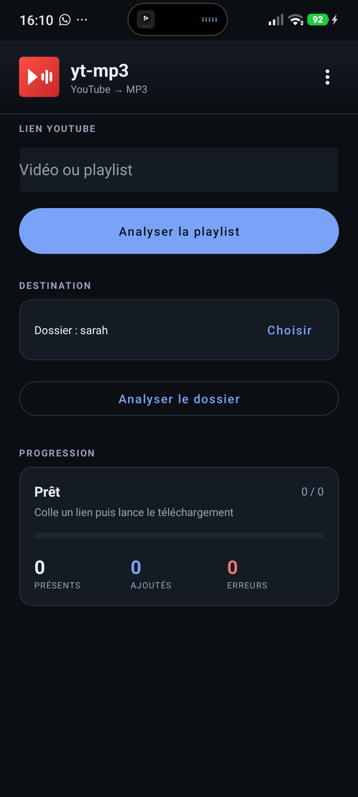
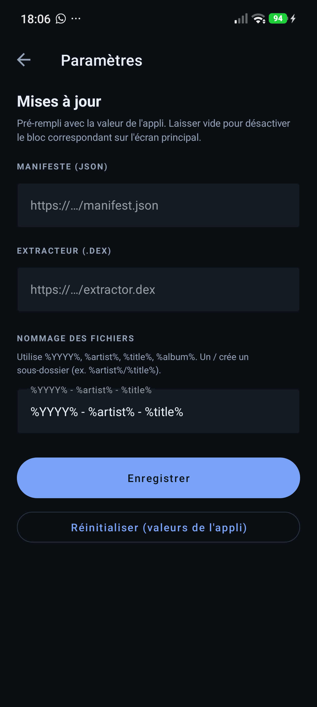
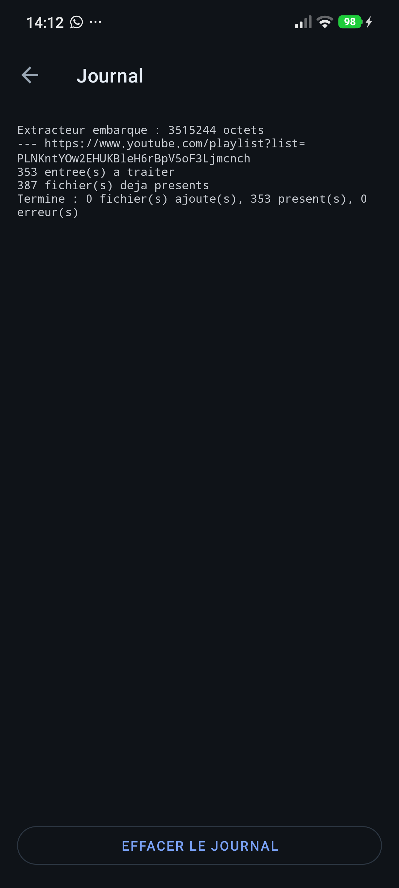
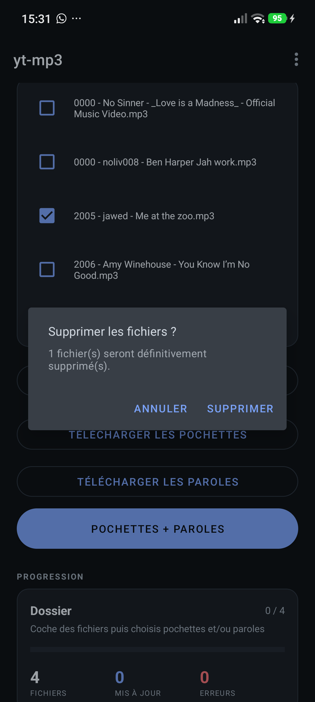
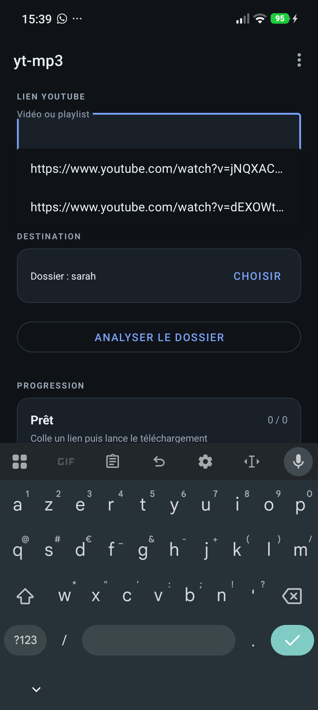

# yt-mp3 — POC Android (v0.4)

APK native Kotlin : télécharge une **vidéo ou une playlist** YouTube, convertit en **mp3**,
tague (titre/artiste/année/album via MusicBrainz), ajoute **pochette** (Cover Art Archive) et
**paroles** (LRCLIB), et enregistre dans le **vrai dossier Musique** du téléphone.

L'extracteur YouTube (NewPipe) est chargé depuis un `.dex` séparé : il peut être **mis à jour
sans réinstaller l'APK**, y compris automatiquement via un manifeste JSON.

---

## Contenu

| Fichier | Rôle |
|---|---|
| `dist/app-debug.apk` | l'application v0.4 (debug) |
| `dist/extractor.dex` | l'extracteur actuel (NewPipe + adaptateur) |
| `dist/manifest.example.json` | exemple de manifeste de mise à jour |
| `build-plugin-dex.sh` | reconstruit `dist/extractor.dex` |

Sources : `/home/franck/opencode-work/android-yt/`

## Écrans

Écran principal :



Paramètres :



Journal :



Confirmation de suppression :



Historique des URLs :



---

## Nouveautés v0.2 / v0.3

- **Playlists** : coller une URL de playlist ; les morceaux déjà présents sont ignorés.
  Toutes les pages sont parcourues (garde-fou : 5000 entrées).
- **Pochettes** : Cover Art Archive via l'ID MusicBrainz.
- **Paroles** : LRCLIB, synchronisées si disponibles (tag ID3 `USLT`).
- **MediaStore** : écriture dans le vrai dossier `Music/yt-mp3/` (Android 10+ sans permission ;
  Android 8–9 demande l'autorisation de stockage).
- **Dossier de destination au choix** : bouton « Choisir un dossier » (sélecteur Android/SAF),
  accès mémorisé entre les lancements. Par défaut : `Music/yt-mp3`.
- **Refonte visuelle** : Material Components (barre supérieure, cartes, champs outlined,
  boutons arrondis, thème sombre).
- **Carte Progression** : barre de progression globale + compteurs **Présents / Ajoutés / Erreurs**
  et l'étape en cours. Le journal détaillé n'encombre plus l'écran principal.
- **Journal dans le menu** (⋮ → Journal) : journal complet, défilement automatique, bouton
  « Effacer le journal ».
- **Analyser le dossier** : liste les mp3 du dossier choisi, cases à cocher, puis
  « Télécharger les pochettes », « Télécharger les paroles » ou « Pochettes + paroles ».
  Option « Inclure les sous-dossiers » (décochée par défaut).
- **Arrêter** les téléchargements/traitements, **Tout cocher / Tout décocher**.
- **Supprimer les fichiers** sélectionnés (analyse du dossier), avec confirmation du nombre.
- **Historique des 10 dernières URLs YouTube** : suggestions à l'édition du champ
  (la plus récente en premier).
- **Icône** : play + waveform, fond dégradé bleu/violet (variantes dans `docs/icon-variants.png`).
- **Menu Paramètres** (⋮ en haut à droite) : les deux URLs de mise à jour y sont éditables,
  pré-remplies avec les valeurs par défaut de l'appli. Elles peuvent être vidées pour
  désactiver les blocs correspondants ; bouton « Réinitialiser » pour revenir aux valeurs de
  l'appli.
- **Manifeste de mise à jour** : extracteur et APK.
- **UI épurée** : les blocs de mise à jour (extracteur et APK) sont masqués tant qu'aucune URL
  n'est définie (par défaut ou via Paramètres). Avec une URL, seul le bouton apparaît.

---

## Installation (sideload)

```bash
adb install -r app-debug.apk
```

Ou copier l'APK sur le téléphone et l'ouvrir (autoriser « Installer des applications inconnues »).

APK signé avec la clé de **debug** : usage local uniquement.

---

## Utilisation

1. Coller une URL de vidéo **ou de playlist** dans le champ du haut.
2. (Optionnel) **Choisir un dossier** de destination. Sans choix, les fichiers vont dans
   `Music/yt-mp3`. Le dossier choisi est mémorisé (accès persistant SAF), y compris sur carte SD.
3. **Télécharger en mp3**.
4. Le journal affiche chaque étape et chaque morceau.

Fichiers produits :

```
<dossier choisi>/ANNEE - Artiste - Titre.mp3
ou, par defaut :
/sdcard/Music/yt-mp3/ANNEE - Artiste - Titre.mp3
```

Ils apparaissent dans le lecteur musique (MediaStore) et sont visibles depuis un gestionnaire
de fichiers.

> Android 8–9 : autoriser le stockage au premier lancement.

---

## Mises à jour

### Extracteur seul

Par défaut :

```kotlin
const val DEFAULT_EXTRACTOR_URL = ""   // ex. "https://exemple/yt-mp3/extractor.dex"
```

Modifiable dans **⋮ → Paramètres** :
- vide → bouton **masqué** ;
- renseignée → seul le bouton **Mettre à jour l'extracteur** apparaît.

L'appli vérifie que le `.dex` se charge avant de remplacer l'ancien.

### Automatique via manifeste

Par défaut, l'appli utilise la valeur définie dans
`app/src/main/java/com/fp/ytmp3/Config.kt` :

```kotlin
const val DEFAULT_MANIFEST_URL = ""   // ex. "https://exemple/yt-mp3/manifest.json"
```

L'utilisateur peut la modifier dans **⋮ → Paramètres** (pré-remplie avec cette valeur).
Règles :
- URL vide → section **masquée** ;
- URL renseignée → seul le bouton **Vérifier les mises à jour** apparaît, et le manifeste
  est vérifié au lancement.

Format :

```json
{
  "extractor": { "version": 2, "url": "https://exemple/extractor.dex" },
  "apk":       { "versionCode": 5, "url": "https://exemple/app-debug.apk" }
}
```

- `extractor.version` : entier, à incrémenter à chaque nouveau `.dex`.
  (la version embarquée est **1**)
- `apk.versionCode` : comparé à celui de l'appli installée (ici **2**).
- L'extracteur est mis à jour silencieusement.
- Pour l'APK, Android ouvre l'installateur ; il faut autoriser « Installer des applications
  inconnues » pour yt-mp3.

Le manifeste est vérifié au lancement et via le bouton **Vérifier les mises à jour**.

### Tester en local

```bash
cd /home/franck/projects/android/yt-mp3-android
cp manifest.example.json manifest.json   # adapter l'IP et les versions
python3 -m http.server 8000
```

Dans l'appli : `http://IP_DU_PC:8000/manifest.json`.

Le POC autorise le HTTP en clair (`usesCleartextTraffic`) pour ce genre de test local.
En usage réel, servir les fichiers en **HTTPS**.

---

## Reconstruire

Prérequis : JDK 17, Android SDK (build-tools 35, platform 34), Gradle 8.7.

```bash
export JAVA_HOME=$HOME/.local/opt/jdk17
export ANDROID_HOME=$HOME/.local/opt/android-sdk
cd /home/franck/opencode-work/android-yt

./build-plugin-dex.sh          # extractor.dex
$HOME/.local/opt/gradle-8.7/bin/gradle --no-daemon :app:assembleDebug
# -> app/build/outputs/apk/debug/app-debug.apk
```

---

## Architecture

```
com.fp.ytmp3 (Kotlin)
 ├─ PluginLoader        DexClassLoader -> ExtractorApi.info()/list()
 ├─ Http                HttpURLConnection
 ├─ AudioConverter      MediaCodec (décodage) + jump3r/LAME (mp3)
 ├─ MusicBrainz         tags + Cover Art Archive + LRCLIB
 ├─ Tagger              mp3agic (ID3v2 : tags, pochette, paroles)
 ├─ MediaStoreUtil      écriture Music/yt-mp3
 └─ Updater             manifeste -> dex + APK

extractor.dex (Java, NewPipe Extractor GPLv3)
 └─ ExtractorApi.info(url) / list(url)
```

L'appli ne référence aucune classe `org.schabi.newpipe` (vérifié : 0 dans son dex).

---

## Vérifié ici

- `BUILD SUCCESSFUL`, APK v0.4 (`versionCode 4`, minSdk 26, targetSdk 34).
- Permissions : INTERNET, WRITE_EXTERNAL_STORAGE (≤ API 28), REQUEST_INSTALL_PACKAGES.
- FileProvider `com.fp.ytmp3.files` présent (installation APK téléchargée).
- `assets/extractor.dex` présent (3,5 Mo), `list()` testé **sur JVM** :
  playlist 353 titres lue, vidéo seule OK.
- Chaîne MP3 testée **sur JVM** : PCM → LAME → mp3 192 kbps valide, tags relus par `ffprobe`.

## Non vérifié ici

- Exécution sur Android (pas de `/dev/kvm` accessible) : à valider sur téléphone —
  `MediaCodec`, `DexClassLoader`, MediaStore, installation d'APK.

---

## Limites

- Playlist : toutes les pages sont lues, avec un garde-fou à 5000 entrées.
- YouTube change souvent : publier un nouveau `dist/extractor.dex` suffit.
- `usesCleartextTraffic=true` pour les tests locaux (à retirer en production).
- APK de debug : signature de test, pas de publication.

## Licences

- NewPipe Extractor : **GPLv3** (sources du module `plugin` à fournir si distribution).
- jump3r (portage Java de LAME) : voir projet d'origine (LAME LGPL).
- mp3agic : MIT.
- Usage personnel ; ne pas publier sur le Play Store.

## Langues

- **Base : anglais** (`values/strings.xml`) — langue par défaut si la langue du téléphone
  n'est pas prise en charge.
- Traductions : **français**, **espagnol**, **allemand** (`values-fr`, `values-es`, `values-de`).
- L'appli suit automatiquement la langue du téléphone.
- Android 13+ : langue par appli via **Paramètres → Applications → yt-mp3 → Langue**
  (fichier `res/xml/locales_config.xml`). En ligne de commande :
  `adb shell cmd locale set-app-locales com.fp.ytmp3 --locales en`.
